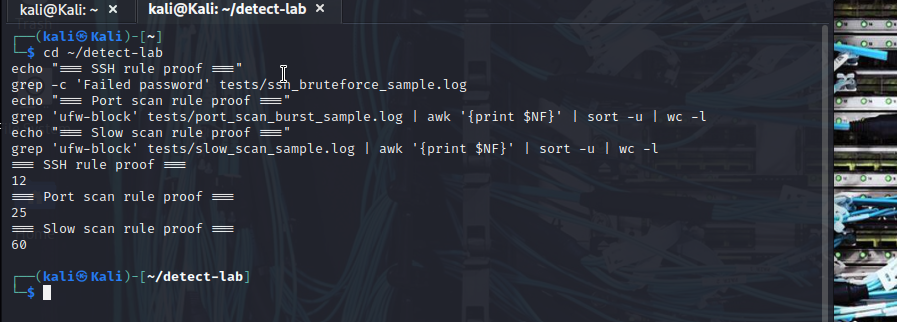

# detect-lab

Sigma detection rules for common Linux attack patterns, each mapped to
MITRE ATT&CK with a documented test case.

## Rules

| Rule | ATT&CK | Description |
|------|--------|-------------|
| `ssh_bruteforce.yml` | T1110.001 | SSH authentication failure burst from a single source |
| `port_scan_burst.yml` | T1046 | High-volume connection attempts from one source in a short window |
| `reverse_shell_devtcp.yml` | T1059.004 | Bash reverse shell via `/dev/tcp` |
| `sudo_abuse.yml` | T1548.003 | Repeated failed sudo attempts from a single user |
| `curl_pipe_bash.yml` | T1059.004 / T1105 | Remote script execution via `curl`/`wget` piped to bash |
| `slow_scan.yml` | T1046 | Low-rate, high-total port scan (evades `port_scan_burst`) |

## Proof

Each rule ships with a sample log in `tests/` and a validation command in its
doc. The screenshot above shows the match counts for three rules, all above
their firing thresholds.

## Structure
rules/       # Sigma rule files (YAML)
docs/        # One markdown per rule: rationale, FP notes, test steps
tests/       # Sample commands to trigger each rule in a lab

## Testing approach
Each rule's doc includes a command you can run in a lab to generate the
event, plus the expected log line. Rules are written to be portable across
backends that support Sigma (Splunk, Elastic, Sentinel).

## Scope
Lab use only. Do not run the test commands against systems you do not own.
